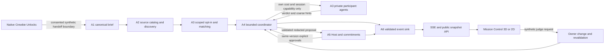

# Crewbie integration architecture

Crewbie — The AI that makes plans actually happen.

The integration branch composes the existing Python services in one trusted process. It retains the Next.js frontend, its 3D work, accessible 2D fallback and clearly labeled independent replay modes. The instruction-only Crewbie Unlocks Skill remains useful without that process.

## Composition and interface decisions

- `services/api/runtime.py` wires actual A1/A2/A3/A4/A5/A6 functions. It does not use negotiation mocks, chat fixture snapshots or the frontend simulator.
- The private service issues session-bound evaluator capabilities. An additive, trusted-bootstrap `minimized_costs=True` option accepts exactly the requesting participant's cost line; default canonical validation is unchanged. Identity, roster, activity and current consent checks remain enforced. No other participant profile is passed to an agent.
- A3's `try_alternate_day` maps to A4's `prefer_different_day`. Hint retrieval reuses the immediately preceding evaluation's coarse hints, avoiding extra private probes. The eight-probe lifetime cap remains unchanged. Searches use three candidates per run; repeated changes can exhaust the cap and fail safely.
- A4's nested snapshot becomes A5's flat `validated` snapshot through an explicit projection. Individual cost estimates are withheld. Aggregate synthetic estimates may appear in the public A4 snapshot; neither private caps nor individual cost lines are exposed.
- A5 exclusively attests `approval_requested` after acknowledged provider delivery and emits `proposal_confirmed`. The event adapter suppresses A4's duplicate authority events. A4 reads actual commitment summaries before its confirmed transition.
- The event adapter maps fairness/failure fields to A6's allowlist, assigns ordered unique public IDs/timestamps, preserves producer dedupe keys and adds judge correlation IDs. A6 validates every public event; rejected payloads are bugs, not silently retried.
- A4 candidate versions are not necessarily the order of winner selection. The frontend honors the explicit `proposal_ready` winner and resets selection on revision. Recorded traces test this contract.
- Live-mode snapshots supply actual itinerary windows, activity descriptions and redacted cost wording. Per-activity timing is not invented. Snapshot/event disagreement is displayed through the existing sync warnings. Events drive status; HTTP acknowledgments do not imply success.
- Withdrawal revokes A3 authorization, clears A5 commitments and invokes A4 withdrawal. Decline vetoes the proposal without revoking the whole activity. Cancellation explicitly closes both services. Weaker replies never establish confirmation.

## Transport and authorization

`python -B -m services.api.main` mounts a stdlib HTTP composition server on **127.0.0.1 only**, reusing A6's SSE handler. There is no database or migration: state and deduplication are in memory and reset on process restart. Production persistence, authentication, session access control and durable provider retries are not implemented. Do not expose this sandbox through a tunnel or deployment.

| Route | Purpose |
|---|---|
| `GET /healthz` | Truthful DEMO/SYNTHETIC and non-durable status |
| `GET /v1/opportunities` | A2 synthetic activity catalog |
| `POST /v1/demo/sessions` | Explicit synthetic scenario seeding; simulated consent required for Unlocks |
| `GET /v1/sessions/{id}/snapshot` | Redacted A4 state plus actual A5 summary |
| `GET /v1/sessions/{id}/events` | A6 SSE with Last-Event-ID resume |
| `POST /v1/sessions/{id}/messages` | Explicit synthetic actor messages; never production identity |
| `POST /v1/sessions/{id}/constraint-changes` | Synthetic-only owner mutation, approval reset and actual revalidation |

Host/Origin checks reject cross-site writes and DNS rebinding. No private profile endpoint exists. Client flags and student IDs are only simulator input; they do not authenticate a real student. Discord identities instead come from the provider event and an explicitly configured test-user allowlist.

## Mock-to-real boundaries

| Boundary | Implemented behavior | Still unverified/unavailable |
|---|---|---|
| Cubbie runtime | Standalone instruction-only Skill; official structural validation passes | Real account install, connected accounts, native scheduling/delivery, backend handoff |
| Scenario A | A1 consent gate -> A2 ASU resource fixture -> A3 matching/mutual introduction checks -> A4 -> A5 -> A6 | Native Skill transport and real ASU inventory/eligibility/opening hours |
| ASU source | Public ASU Library resource description and original URL are retained | Proposed slot, participants and inventory are synthetic; no enrollment or reservation |
| Scenarios B/C | Real private policies, generation, counteroffers, deterministic checks and commitments | Profiles, prices, venue/travel/lodging assumptions are synthetic |
| Local group chat | Actual Host/commitment calls with mock provider acknowledgments | External delivery |
| Discord | Real gateway SDK and channel-send adapter; fake external transport tests | Authorized bot/channel/token and real delivery rehearsal; no DM/stranger introduction connector |
| Mission Control | Live SSE, snapshot fetch and real judge backend | Standalone Quick/Weekend tabs still use their explicitly labeled local simulator |

## Sources inspected

Official Cubbie instructions: https://hackathon.cubbie.ai/skill.md (retrieved by curl; web reader could not open it). Official creator kit pinned at `bc505e9c41ea91de77f7a8b57214fd10901a100f`: https://github.com/imaginix-inc/cubbie-hackathon-kit. Discord gateway: https://docs.discord.com/developers/events/gateway; SDK quickstart: https://discordpy.readthedocs.io/en/stable/quickstart.html. ASU resource: https://lib.asu.edu/services/undergraduate-students (public description, not a schedule or inventory feed).
