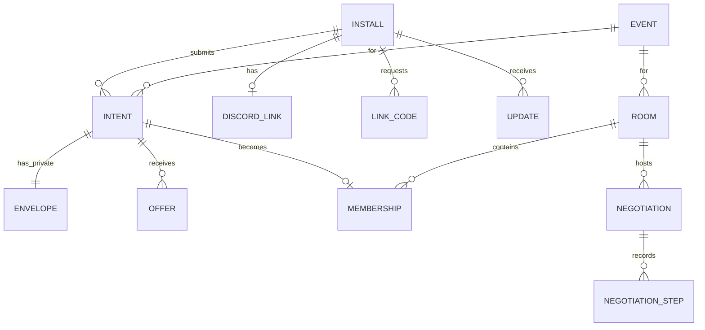
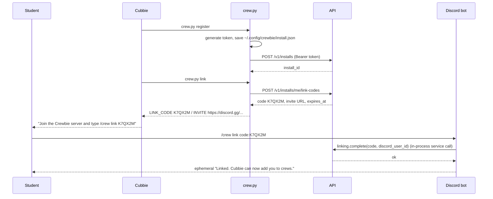
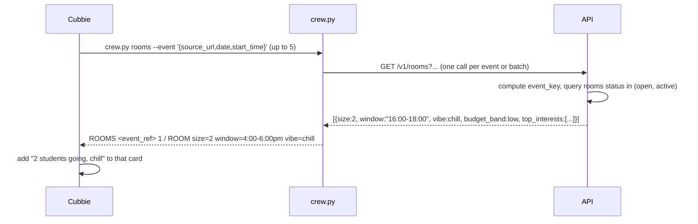
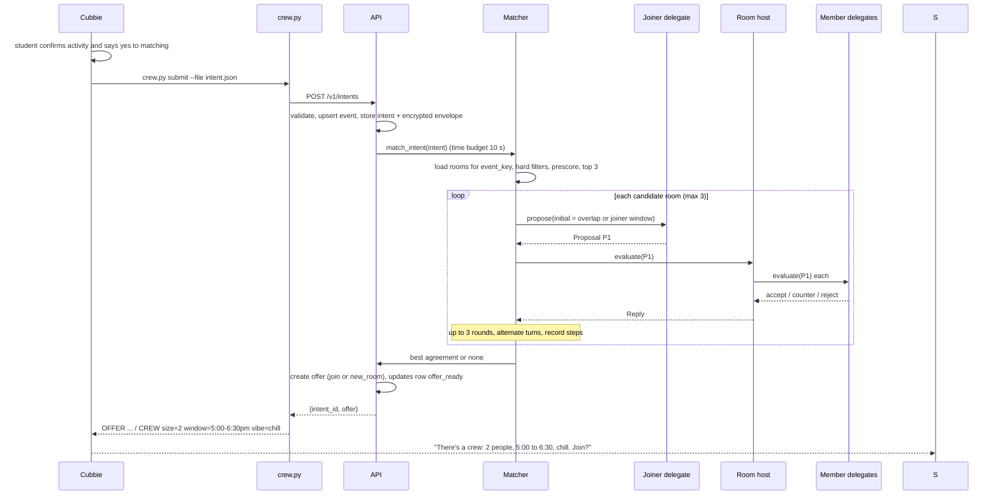
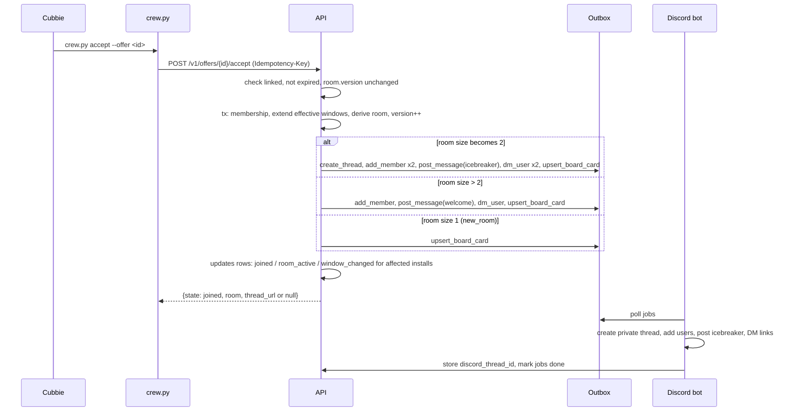
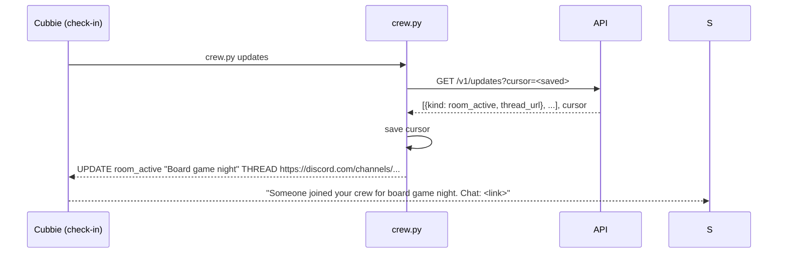
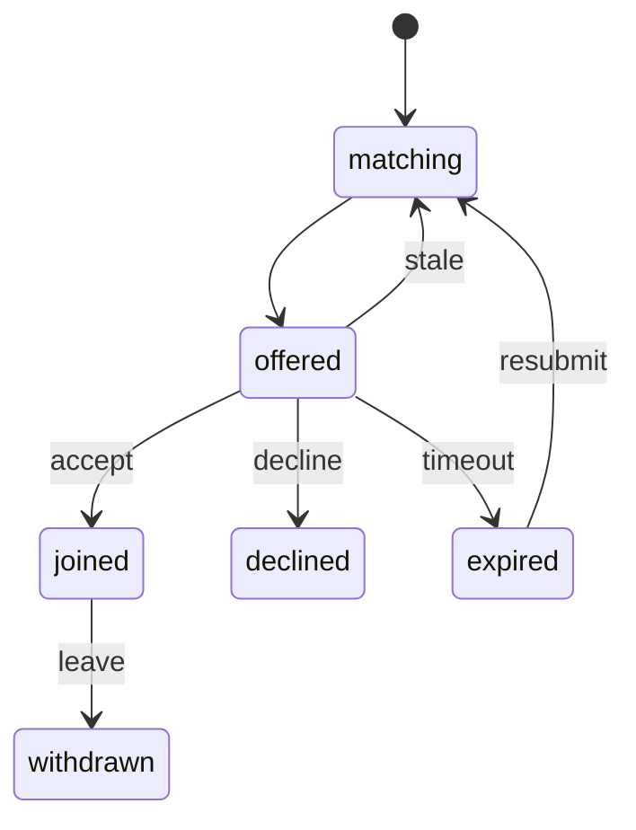
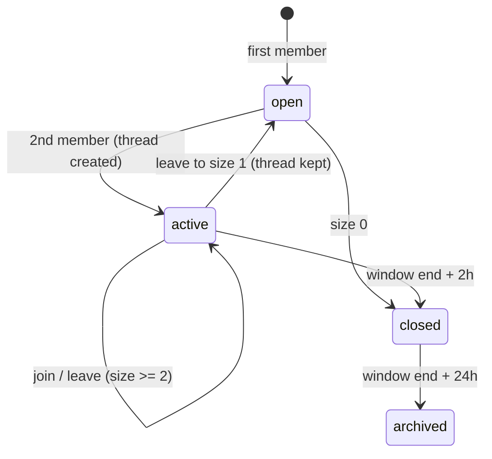

# Architecture

## 1. Components

| Component | Responsibility | Location |
|---|---|---|
| Cubbie Skill | Talks to the student, collects consent, runs `crew.py` | `skills/crewbie-unlocks/` |
| `crew.py` | Stateless HTTPS client with local credential and cursor storage | `skills/crewbie-unlocks/scripts/crew.py` |
| API | HTTP surface, auth, validation, rate limits | `src/crewbie/api/` |
| Application services | Use cases: submit intent, accept offer, link account, leave | `src/crewbie/services/` |
| Domain | Pure logic: event key, windows, room derivation, offer rules | `src/crewbie/domain/` |
| Matcher | Candidate selection, negotiation orchestration, offer creation | `src/crewbie/matching/` |
| Agents | Delegate and host policies; optional LLM layer | `src/crewbie/agents/` |
| Persistence | SQLAlchemy models, repositories, unit of work | `src/crewbie/persistence/` |
| Outbox | Durable queue of Discord side effects | `src/crewbie/persistence/outbox.py` + `src/crewbie/discord_bot/worker.py` |
| Discord bot | Slash commands, buttons, modals, thread management, facilitation | `src/crewbie/discord_bot/` |
| Telemetry | Public-safe event log and SSE stream | `src/crewbie/telemetry/` |
| Mission Control | Visualization (existing Next.js app) | `apps/web/` |

API and bot run in one process (`python -m crewbie`): Uvicorn serves FastAPI, and the discord.py client plus the
outbox worker run as asyncio tasks started in the FastAPI lifespan. They share the database, never in-memory
state, so they can be split into two processes later without code changes.

## 2. Directory structure

```
.
├── CLAUDE.md
├── README.md
├── pyproject.toml                  # uv, ruff, mypy, pytest config
├── uv.lock
├── Dockerfile
├── .env.example
├── src/
│   └── crewbie/
│       ├── __init__.py
│       ├── __main__.py             # entrypoint: runs uvicorn with app factory
│       ├── config.py               # pydantic-settings; `python -m crewbie.config check`
│       ├── logging.py              # JSON logging, redaction filter
│       ├── domain/                 # pure, no IO, fully typed
│       │   ├── event_key.py
│       │   ├── windows.py          # TimeWindow value object: overlap, intersect, hull, duration
│       │   ├── budget.py           # BudgetBand enum + ordering
│       │   ├── vibe.py
│       │   ├── intent.py           # SharedIntent, PrivateEnvelope (frozen dataclasses)
│       │   ├── room.py             # derive_room_state(memberships) -> RoomState
│       │   ├── offer.py            # Offer rules: expiry, staleness
│       │   └── errors.py           # DomainError subclasses with stable codes
│       ├── agents/
│       │   ├── protocol.py         # Proposal, Verdict, Reply (no reason field)
│       │   ├── delegate.py         # DelegatePolicy (deterministic guard + optional LLM chooser)
│       │   ├── host.py             # HostPolicy: fan-out to member delegates, merge counters
│       │   ├── llm/
│       │   │   ├── client.py       # thin Anthropic wrapper, timeouts, retries
│       │   │   ├── schemas.py      # strict output schemas
│       │   │   └── prompts/        # .md prompt templates with delimited data blocks
│       │   └── aliases.py          # per-room opaque actor refs (member-1, member-2)
│       ├── matching/
│       │   ├── prescore.py
│       │   ├── negotiation.py      # run_negotiation(joiner, host, max_rounds)
│       │   └── matcher.py          # match_intent(intent) -> Offer
│       ├── services/               # application layer; one module per use case
│       │   ├── installs.py
│       │   ├── linking.py
│       │   ├── discovery.py
│       │   ├── intents.py
│       │   ├── offers.py
│       │   ├── rooms.py
│       │   └── updates.py
│       ├── persistence/
│       │   ├── db.py               # engine, session factory, migrations bootstrap
│       │   ├── tables.py           # SQLAlchemy 2.0 typed mappings
│       │   ├── crypto.py           # Fernet envelope encryption
│       │   ├── unit_of_work.py
│       │   ├── outbox.py
│       │   └── repositories/
│       │       ├── installs.py
│       │       ├── events.py
│       │       ├── intents.py
│       │       ├── rooms.py
│       │       ├── offers.py
│       │       └── updates.py
│       ├── api/
│       │   ├── app.py              # create_app(); lifespan starts bot + workers
│       │   ├── auth.py             # bearer token -> Install
│       │   ├── rate_limit.py
│       │   ├── errors.py           # DomainError -> HTTP mapping
│       │   ├── schemas.py          # request/response models
│       │   └── routers/
│       │       ├── health.py
│       │       ├── installs.py
│       │       ├── rooms.py
│       │       ├── intents.py
│       │       ├── offers.py
│       │       ├── updates.py
│       │       ├── stream.py
│       │       └── admin.py
│       ├── discord_bot/
│       │   ├── client.py           # discord.Client subclass, command tree sync
│       │   ├── commands/
│       │   │   ├── link.py
│       │   │   └── crew.py         # /crew leave, /crew status, /crew meetpoint
│       │   ├── views/
│       │   │   ├── board_card.py   # Join button
│       │   │   └── join_modal.py
│       │   ├── worker.py           # outbox consumer
│       │   ├── icebreaker.py
│       │   ├── facilitation.py     # reminders, mention Q&A
│       │   └── messages.py         # all user-facing strings in one place
│       ├── workers/
│       │   ├── offer_sweeper.py
│       │   ├── room_lifecycle.py   # close/archive by time
│       │   └── reminders.py
│       └── telemetry/
│           ├── public_events.py    # allowlisted serializer
│           └── sse.py
├── skills/
│   └── crewbie-unlocks/
│       ├── SKILL.md
│       └── scripts/
│           └── crew.py
├── apps/
│   └── web/                        # Mission Control (existing)
├── scripts/
│   └── dev/
│       ├── seed.py
│       └── simulate.py             # drive N synthetic intents against a local server
├── tests/
│   ├── conftest.py
│   ├── unit/                       # domain, agents, matching
│   ├── integration/                # api + db, bot worker with fake Discord
│   ├── privacy/                    # envelope leak tests
│   ├── skill/                      # crew.py against a test server
│   └── e2e/                        # marked e2e; needs running server
├── docs/
│   └── spec/
└── legacy/                         # previous prototype, read-only reference
    ├── services/
    ├── integrations/
    ├── apps_chat_bot/
    └── tests/
```

## 3. Data model

Mermaid ERD (all timestamps UTC in storage; displayed in `America/Phoenix`):



Tables (columns abbreviated; all have `created_at`, `updated_at`):

| Table | Key columns |
|---|---|
| `installs` | `id` (uuid), `token_hash` (unique), `kind` (`cubbie`/`discord`), `is_synthetic` |
| `discord_links` | `install_id` (pk, fk), `discord_user_id` (unique), `discord_username` |
| `link_codes` | `code` (pk), `install_id`, `expires_at`, `used_at` |
| `events` | `event_key` (pk), `source_url`, `title`, `location_label`, `date`, `start_time`, `end_time` |
| `intents` | `id`, `install_id`, `event_key`, `window_start`, `window_end`, `activity_min_minutes`, `budget_band`, `vibe`, `interests` (json), `state`, unique(`install_id`,`event_key`) where state live |
| `envelopes` | `intent_id` (pk), `ciphertext` (Fernet of `{flex_earliest, flex_latest, budget_cap_usd}`) |
| `rooms` | `id`, `event_key`, `status`, `version`, derived: `window_start`, `window_end`, `budget_band`, `vibe`, `top_interests`, `size`; `discord_thread_id`, `board_message_id` |
| `memberships` | `id`, `room_id`, `intent_id` (unique), `alias` (`member-N`), `effective_start`, `effective_end`, `joined_at`, `left_at` |
| `offers` | `id`, `intent_id`, `type`, `room_id` (nullable), `room_version`, `proposal_start`, `proposal_end`, `expires_at`, `state` |
| `negotiations` | `id`, `intent_id`, `room_id`, `outcome`, `rounds` |
| `negotiation_steps` | `negotiation_id`, `round`, `actor_kind`, `actor_alias`, `proposal_start`, `proposal_end`, `verdict` |
| `updates` | `seq` (autoincrement), `install_id`, `kind`, `payload` (json, public-safe), `created_at` |
| `outbox` | `id`, `kind`, `payload` (json), `dedupe_key` (unique), `state`, `attempts`, `next_attempt_at`, `last_error` |
| `public_events` | `seq`, `type`, `payload` (json, allowlisted), `created_at` |

Rules:

- Only `services/` opens transactions (unit of work). Repositories never commit.
- Every state change that needs a Discord action writes an `outbox` row in the same transaction.
- Every state change the student should hear about writes an `updates` row in the same transaction.

## 4. Data flows

### 4.1 Register and link



### 4.2 Discovery during recommendations



### 4.3 Submit, negotiate, offer



### 4.4 Accept and thread creation



### 4.5 Scheduled check-in



### 4.6 Leave

`crew.py leave --intent <id>` or `/crew leave` in the thread → `services.rooms.leave` → membership `left_at` set,
room derived again, `version++`, outbox `remove_member` + `post_message` ("member-2 left; plan is now 4:00 to
6:30"), updates `window_changed` for remaining members, status `closed` if empty.

### 4.7 Discord-only join from the board

Join button → modal → `services.intents.submit` with a Discord install (created on first use) → matching scoped
to that board room first (it is the only candidate) → if agreement, ephemeral "Join this crew? [Confirm]" →
confirm calls `services.offers.accept`. If no agreement, ephemeral explanation that the timing does not fit and an
offer to start a new crew.

## 5. State machines

Intent:



Offer: `open → accepted | declined | expired | stale`.

Room:



## 6. Process model and concurrency

- One Uvicorn worker. SQLite in WAL mode. All writes go through the unit of work.
- Accept and matching for the same room are serialized with a per-room `asyncio.Lock` registry plus the
  `room.version` check (optimistic concurrency) so a future multi-process deployment stays correct.
- LLM calls run outside DB transactions. The matcher snapshots room state, negotiates, then the offer stores the
  `room_version` it used.

## 7. Reuse from the previous prototype

| Legacy module | Reuse |
|---|---|
| `legacy/services/participants/` | Ideas: scoped consent, probe caps, minimized views. Do not import. |
| `legacy/services/negotiation/coordinator.py` | Ideas: bounded rounds, event emission. Rewrite smaller. |
| `legacy/services/realtime/schema.py` | Copy the allowlist approach into `telemetry/public_events.py`. |
| `legacy/apps_chat_bot/discord_live.py` | Reference for discord.py setup and `AllowedMentions.none()`. |
| `skills/crewbie-unlocks/SKILL.md` | Kept; "Find a crew" section rewritten per 06-CUBBIE-SKILL.md. |
| `apps/web/` | Kept; add an adapter for the new stream in Phase 7. |
